# 🏛️ Architecture Specification: CRM Intelligence Platform

## Executive Summary

The **CRM Intelligence Platform** is a full-stack, enterprise-ready Customer Relationship Management application designed to bridge traditional account relationship management with automated, predictive decision intelligence. Built on Next.js, Node.js, and PostgreSQL, the platform delivers an autonomous feedback loop: continuous ingestion of customer touchpoints feeds a real-time behavioral heuristics engine, evaluating account churn vulnerability and queueing automated outreach interventions via background scheduler workflows.

---

## High-Level Architecture Topology

```
+-------------------------------------------------------------------------+
|                        LAYER 4: PRESENTATION LAYER                      |
|           Next.js 16 (Pages Router) + React 19 + Responsive CSS         |
|  [ Dashboard ]  [ Customer Directory ]  [ Follow-ups ]  [ Customer 360 ]|
+-------------------------------------------------------------------------+
                                    │  ▲
              JSON REST Payloads    │  │  Bearer JWT Authorization
                                    ▼  │
+-------------------------------------------------------------------------+
|                        LAYER 3: API & DECISION LAYER                    |
|           Next.js Serverless API Handlers + Decision Engine             |
|  • /api/auth/*         • /api/customers/*       • /api/interactions/*   |
|  • /api/followups/*    • /api/ai/decision       • /api/automation/*     |
|  ┌───────────────────────────────────────────────────────────────────┐  |
|  │ AI Decision Engine (lib/decisionEngine.js)                         │  |
|  │ Churn Model: 0-100 Risk Score | Priority Queue: Dynamic Weighting │  |
|  └───────────────────────────────────────────────────────────────────┘  |
|  ┌───────────────────────────────────────────────────────────────────┐  |
|  │ Background Automation Scheduler (node-cron / runScheduler.js)     │  |
|  │ Periodic Inactivity Sweeper | Automated Nodemailer Dispatcher     │  |
|  └───────────────────────────────────────────────────────────────────┘  |
+-------------------------------------------------------------------------+
                                    │  ▲
              Connection Pooling    │  │  Parameterized SQL Queries
                                    ▼  │
+-------------------------------------------------------------------------+
|                    LAYER 2: PERSISTENCE & DATA LAYER                    |
|             PostgreSQL 16 Relational Engine + `pg` Pool                 |
|  [ users ]  [ customers ]  [ interactions ]  [ followups ]  [ audit ]   |
+-------------------------------------------------------------------------+
                                    ▲
                                    │ Validated Claims
+-------------------------------------------------------------------------+
|                    LAYER 1: AUTHENTICATION & SECURITY                   |
|  • HMAC SHA-256 JWT Signing (lib/auth.js)                               |
|  • Salted bcrypt Hashing (10 rounds) for Credential Storage             |
|  • Role-Based Access Control (RBAC: Admin / Agent / User)               |
|  • Request-level Token Verification Middleware                          |
+-------------------------------------------------------------------------+
```

---

## Detailed 4-Layer Architecture Breakdown

### 1. Layer 1: Authentication & Security Architecture
Security in the CRM is implemented defensively across data-at-rest, data-in-transit, and request routing boundaries:
- **Credential Storage**: User passwords never exist in plaintext. During registration (`/api/auth/register`), passwords are hashed with `bcrypt` using an adaptive work factor of 10 salt rounds before storage in the `users` table.
- **Stateless Session Tokens**: Authentication produces JSON Web Tokens (JWT) signed with HMAC SHA-256 using an environment-isolated `JWT_SECRET`. Tokens encapsulate user identity claims (`id`, `name`, `email`, and `role`) with a 24-hour expiration window.
- **Verification Middleware**: The `verifyToken(req)` routine located in [`lib/auth.js`](file:///c:/Users/malha/mini-crm/lib/auth.js) intercepts incoming protected requests. It validates standard HTTP `Authorization: Bearer <token>` headers, throwing typed errors when tokens are expired, missing, or altered.
- **Role Isolation**: Role-based access validation (`hasRole`) ensures administrative operations are gated appropriately between operational agents and system managers.

### 2. Layer 2: Persistence & Data Layer Architecture
The persistence layer utilizes PostgreSQL 16 managed through Node.js connection pooling via the official `pg` driver:
- **Connection Resilience**: [`lib/db.js`](file:///c:/Users/malha/mini-crm/lib/db.js) configures a managed `Pool` supporting dynamic environment variable configuration (`DATABASE_URL` with SSL support, or discrete `PGUSER`, `PGHOST`, `PGPORT`, `PGDATABASE`, and `PGPASSWORD` settings).
- **Relational Integrity**:
  - `users`: Stores system operators with unique email constraints.
  - `customers`: Tracks business accounts, contact details, assigned account managers, and lifecycle status.
  - `interactions`: Implements foreign key cascades to `customers` (`ON DELETE CASCADE`), storing date-stamped touchpoints (calls, meetings, emails) with operational notes.
  - `followups`: Action queue linking pending interventions, target deadlines, and resolution statuses.
  - `audit_logs`: Append-only immutable log recording system state transitions, authorization events, and scheduler triggers.
- **SQL Injection Prevention**: All queries strictly utilize parameterized placeholders (`$1, $2, ...`) eliminating raw query concatenation vulnerabilities.

### 3. Layer 3: API & Business Logic Layer
The business logic tier comprises Next.js API route handlers, input validation schemas, the AI Decision Engine, and the background scheduler:
- **API Routing Matrix**:
  - Auth: `/api/auth/register`, `/api/auth/login`, `/api/protected`
  - Customer CRUD: `/api/customers/list`, `/api/customers/add`, `/api/customers/update`, `/api/customers/delete`, `/api/customers/overdue`
  - Touchpoints: `/api/interactions/list`, `/api/interactions/add`, `/api/interactions/customer`
  - Intelligent Interventions: `/api/ai/decision`, `/api/followups/churn`, `/api/followups/priority`, `/api/followups/action`
  - Automated Workflows: `/api/automation/pending-followups`, `/api/test-db`
- **AI Decision Engine**: [`lib/decisionEngine.js`](file:///c:/Users/malha/mini-crm/lib/decisionEngine.js) analyzes touchpoint recency and velocity:
  $$\text{Churn Risk} = \min(100, \max(0, (\text{Days Inactive} \times 4.0) - (\text{Interaction Count} \times 2.5)))$$
  $$\text{Priority Score} = (\text{Interaction Count} \times 2) + \text{Days Inactive} + \text{Monetary Weight}$$
  The engine categorizes accounts into a 5-tier intervention matrix:
  - **CRITICAL** (Churn > 70% & Priority > 20): Triggers `ESCALATE_MANAGER` for executive sponsor intervention.
  - **HIGH** (Churn > 60%): Prescribes `CALL_CUSTOMER` for immediate account rep outreach.
  - **MEDIUM** (Churn > 40%): Triggers `SEND_EMAIL` nurturing sequences.
  - **LOW** (Inactivity $\ge$ 30 days): Flags `SCHEDULE_REVIEW`.
  - **SAFE**: Account in good standing; `NO_ACTION`.
- **Automation Scheduler**: Implemented via `node-cron` in [`lib/scheduler/followupScheduler.js`](file:///c:/Users/malha/mini-crm/lib/scheduler/followupScheduler.js), periodically running SQL aggregation sweeps for accounts uncontacted within 7+ days and dispatching automated notifications through Nodemailer.

### 4. Layer 4: Presentation & UI Layer
The user interface is engineered in Next.js 16 and React 19:
- **Executive Intelligence Dashboard** (`pages/dashboard.js`): High-density operational cockpit presenting KPI summary cards (Total Accounts, High Priority, Escalations Required, Churn Distribution) coupled with an actionable data table.
- **Single-Click Intervention Workflows**: Operators can trigger phone call completions or email workflows directly from table row action buttons, immediately logging audit records and updating state.
- **Customer Directory & 360 View** (`pages/customers.js`, `pages/customer/[id].js`): Comprehensive customer profile inspection, interaction timelines, and contact history.
- **Responsive Theme System**: Clean dark/light theme support adhering to WCAG contrast standards.

---

## Data Flow: Customer Lifecycle & Decision Loop

```mermaid
sequenceDiagram
    autonumber
    actor Agent as Account Executive
    participant UI as Dashboard (Next.js)
    participant API as /api/ai/decision
    participant Engine as AI Decision Engine
    participant DB as PostgreSQL 16
    participant Cron as Automation Scheduler
    participant Mailer as Nodemailer Gateway

    Agent->>UI: Views CRM Dashboard
    UI->>API: GET /api/ai/decision (Bearer JWT)
    API->>DB: Query customer touchpoints & inactivity aggregates
    DB-->>API: Returns aggregated interaction stats
    API->>Engine: Run decideAction(customer)
    Engine-->>API: Returns enriched { churnScore, priorityScore, ai_action }
    API-->>UI: Deliver JSON telemetry
    UI-->>Agent: Displays prioritized action queue

    rect rgb(20, 25, 35)
        note right of Cron: Asynchronous Background Loop
        Cron->>DB: Query accounts uncontacted > 7 days
        DB-->>Cron: Customer candidate records
        Cron->>Mailer: Dispatch FOLLOWUP_REMINDER email
        Mailer-->>Cron: Delivery confirmation
        Cron->>DB: Record interaction & audit log entry
    end
```



---

## Scalability & Deployment Architecture

1. **Stateless API Handlers**: Because session state is encapsulated in JWT claims and data is persisted in PostgreSQL, the Next.js API instances scale horizontally behind any reverse proxy or load balancer.
2. **Database Pooling**: The connection pool maintains up to 20 concurrent connections with automated idle timeout recycling, preventing connection starvation under high concurrency.
3. **Containerized Portability**: Docker containerization (`Dockerfile` and `docker-compose.yml`) isolates the application runtime, database server, and volume storage for instant local or cloud reproducibility.
